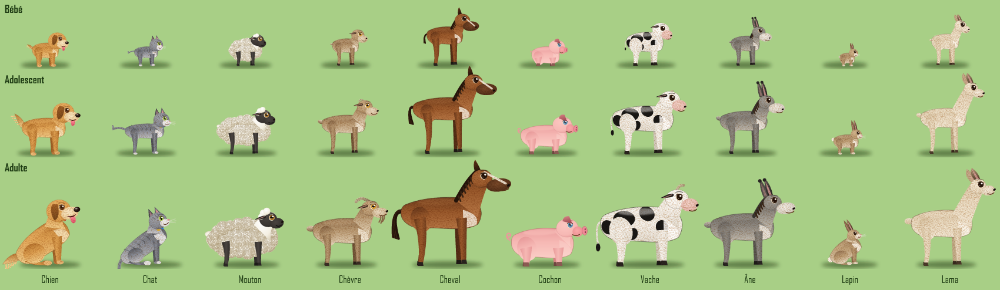
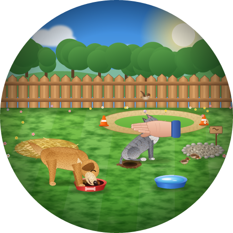
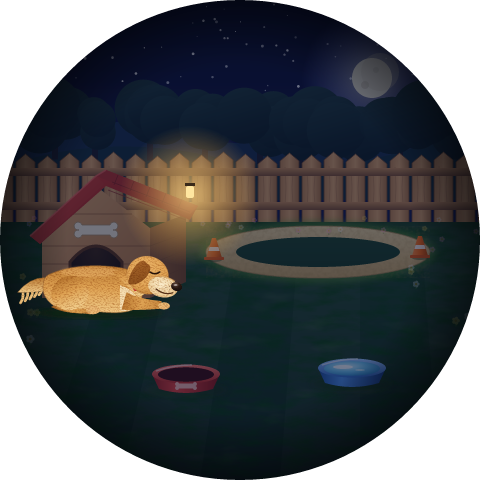

# ZX2D10GE01R : animal de compagnie virtuel dans sa cour
<!-- ⚫ MODIFIÉ (25/10/2026) : titre (était « ZX2D10GE01R : Kiko, chien virtuel dans sa cour », puis « Animal de compagnie ») -->
ZX2D10GE01R base on https://github.com/espressif/esp-idf/tree/release/v5.0

<!-- ⚫ MODIFIÉ (24/10/2026) : le projet devient un firmware "Animal de compagnie" (type Tamagotchi) -->
<!-- ⚫ RETIRÉ (24/10/2026) : sections sur les démos LVGL (menu principal, Widgets, Keypad and encoder, Benchmark,
     Stress, Music, Animations LED, chenillard, options "ZX2D10 Demo", firmwares par démo) : plus de démo dans ce projet. -->
> **Origine :** fork de [wireless-tag-com/ZX2D10GE01R-V4848](https://github.com/wireless-tag-com/ZX2D10GE01R-V4848)
> (projet d'origine du fabricant de la carte). Cette version remplace les démos LVGL par un **animal de compagnie
> virtuel** façon Tamagotchi, piloté à l'encodeur, dont l'état est aussi affiché sur l'anneau de LED.
>
> <!-- ⚫ MODIFIÉ (25/10/2026) : plusieurs animaux, adoption, tableau de bord web -->
> <!-- ⚫ MODIFIÉ (25/10/2026) : 10 espèces, 3 âges, météo et heure réelles, IA, sons -->
> On **adopte** son animal depuis un téléphone (QR code à l'écran) parmi **10 espèces** : chien, chat, mouton,
> chèvre, cheval, cochon, vache, âne, lapin, lama. Il grandit (**bébé, adolescent, adulte**) et vit dans une cour :
> abri et litière de paille, piste avec ses cônes, gamelles, coin besoins. Le ciel suit **l'heure et la météo
> réelles** du lieu (Internet), une **IA gratuite** peut lui donner sa personnalité, et la page web de la carte
> affiche la même scène en direct, avec les **sons** de l'animal.

<!-- ⚫ MODIFIÉ (25/10/2026) : 10 espèces x 3 âges (était : les six animaux) -->


<!-- ⚫ MODIFIÉ (25/10/2026) : nouveaux aperçus (plus de niche) -->
| Le jour : repas, câlin, oiseaux, un trou creusé | La nuit : dodo sur la paille, gamelle renversée |
|---|---|
|  |  |

*Aperçus composés à partir des images du firmware (plusieurs animaux réunis pour l'exemple : on n'en adopte qu'un ;
les jauges, la bulle et le sélecteur s'affichent par-dessus).*

## Matériel / environnement

- ESP32-S3 N16R8 : flash 16 Mo, PSRAM **octale** 8 Mo, écran rond RGB 480×480 (frame buffer en PSRAM, `fb_in_psram`) + encodeur MT8901.
- Encodeur : rotation sur GPIO 5/6 (MT8901), bouton-poussoir sur GPIO 3 (actif bas), anneau de **13 LED WS2812** sur GPIO 4.
- ESP-IDF **v5.0.9**.
- <!-- ⚫ AJOUTÉ (25/10/2026) --> Pas de haut-parleur sur la carte, et l'ESP32-S3 ne gère que le **Bluetooth basse
  consommation** (pas le Bluetooth « classique » des enceintes) : les **sons** sont joués par la page web (voir plus
  bas) ; appairer le téléphone à une enceinte Bluetooth pour les entendre dessus.

<!-- ⚫ AJOUTÉ (25/10/2026) -->
## Adopter son animal

1. Au premier démarrage (ou après une réinitialisation), l'écran affiche **« Adopte ton animal ! »** et un **QR code**.
2. Le scanner avec l'appareil photo du téléphone : il rejoint le réseau WiFi **`AnimalDeCompagnie_WiFi`** (ouvert)
   et la page de la carte s'ouvre toute seule (sinon : `http://192.168.4.1`).
3. Choisir l'espèce (vignettes), saisir le nom (16 caractères au plus), **Adopter** : l'animal entre dans la cour.
4. *(conseillé)* Dans **WiFi de la maison**, connecter la carte à votre box : heure, météo, IA et accès à la page
   depuis le réseau de la maison.

**Le nom et l'espèce sont définitifs** : pour les changer, il faut **tout réinitialiser** depuis la page
(bouton *Tout réinitialiser* : efface l'animal, son âge, ses jauges et la cour ; le WiFi de la maison est gardé).

## Jouer

| Geste | Effet |
|---|---|
| **Tourner** l'encodeur | parcourir le menu (liste circulaire en bas de l'écran) |
| **Appuyer** | réaliser l'action, ou ouvrir un sous-menu (**Jeux**, **Connectivité**) |
| Appuyer pendant que l'animal **dort** | le réveiller (grognon, petit nuage gris, s'il n'a pas assez dormi) |

Les mêmes actions se lancent aussi depuis la page web (boutons sous les jauges).

<!-- ⚫ MODIFIÉ (25/10/2026) : menu principal + menu Jeux -->
<!-- ⚫ MODIFIÉ (25/10/2026) : + Soigner, Connectivité (remplace WiFi) ; trous rebouchés ; gestes -->
### Menu principal

| Action | Effet |
|---|---|
| **Manger** | va à sa gamelle remplie de croquettes : satiété +30 ; remet droite une gamelle renversée. Nourri alors qu'il n'a **plus faim** : risque d'**indigestion** (il tombe malade) ; refuse s'il est plein |
| **Boire** | boit à la gamelle d'eau : hydratation +35 (refuse s'il n'a pas soif) ; remet droite une gamelle renversée |
| **Dormir** | va se coucher sur la litière, sous l'abri ; recharge son énergie ; se réveille seul (la nuit, au lever du jour) |
| **Jeux >** | ouvre le menu des jeux de son espèce (voir ci-dessous) |
| **Besoins** | l'emmène au coin gravier : ses besoins y restent jusqu'au nettoyage — à faire quand il le **demande** |
| **Nettoyer** | **rebouche les trous** (terre fraîche, le gazon repousse en ~8 h), ramasse les besoins, redresse les gamelles et les cônes |
| **Caresser** | une **main** vient le caresser : bonheur +10 (pendant une bêtise, ça l'encourage) |
| **Gronder** | une main agite **l'index levé** au-dessus de lui : corrige une bêtise (« ! », discipline +15) ; **sans raison**, il ne comprend pas (« ? »), pleure et perd un peu de santé |
| **Punir** | la main lui montre le coin, il y va tête basse : **cœur brisé** au-dessus de lui (temps mort, sans violence) ; corrige fortement une bêtise ; **sans raison**, il pleure et perd de la santé. Un **bébé** est trop petit pour comprendre : il a peur (mieux vaut le gronder) |
| **Réconforter** | la main le console : sèche ses larmes |
| **Soigner** | médicament quand il est **malade** : il guérira plus vite en se reposant |
| **Connectivité >** | **WiFi** (QR code : réseau de la carte, ou adresse de la page sur le WiFi de la maison), **Son** oui / non, **Volume** 1 à 3, **IA** (état et dernière phrase) |

<!-- ⚫ MODIFIÉ (25/10/2026) : jeux propres à chaque espèce -->
### Menu Jeux (selon l'espèce)

| Jeu | Espèces | Effet |
|---|---|---|
| **Courir** | chien, mouton, chèvre, cheval, cochon, âne, lapin, lama | tours de piste derrière la balle |
| **Balle** | chien | la balle est lancée au fond de la cour : il la rapporte |
| **Frisbee** | chien | il saute pour l'attraper au vol |
| **Os à ronger** | chien | il le ronge, le lance, le rattrape, puis **l'enterre** ; il ira le **déterrer** plus tard (de lui-même ou au prochain « Os ») pour jouer et le recacher dans le même trou |
| **Oiseaux** | chien, chat | des oiseaux se posent : il leur court après (jamais hors de l'écran) |
| **Pelote** | chat | il la fait rouler d'un coup de patte |
| **Plume** | chat | il saute pour attraper la plume au bout de la canne |
| **Obstacle** | chèvre, cheval, âne, lama | élan, saut de la haie |
| **Carotte** | cheval, cochon, âne, lapin | une main la lui tend, il la croque |
| **Bain de boue** | cochon | il s'y roule (reste crotté un moment) |
| **Grimper** | chèvre | sur la botte de foin |
| **Brossage** | mouton, cheval, vache, âne, lama | une main le brosse |
| **Brouter** | mouton, chèvre, vache, lapin, lama | une touffe d'herbe fraîche |
| **Retour** | | revient au menu principal (automatique après 30 s) |

### L'écran

- **La cour** : palissade, arbres, pelouse, **abri** avec litière de paille, piste en sable et ses deux **cônes**,
  gamelles, coin besoins (gravier).
- **Le ciel suit la réalité** <!-- ⚫ AJOUTÉ (25/10/2026) --> : jour, aube / crépuscule, nuit selon le lever et le
  coucher du soleil du lieu ; ciel dégagé, nuageux, couvert, **pluie** (gouttes, éclaboussures), **neige**,
  **orage** (éclairs), **brouillard**. Papillon par beau temps, oiseaux, lucioles les nuits douces.
- **L'animal** vit selon son humeur, son âge et le temps qu'il fait : il attend devant sa gamelle quand il a faim,
  près du coin besoins quand il doit sortir, va s'allonger sur sa litière quand il est fatigué, se balade partout
  sur la pelouse, renifle (les herbivores broutent), poursuit les oiseaux. **Il pleut, il neige, il gèle ou il
  fait très chaud : il file à l'abri** (et s'ébroue quand la pluie s'arrête). Il ne sort jamais de l'écran et
  n'entre dans l'abri que par l'avant.
- **Émotions** : cœur quand il est heureux ; **bulles de pensée** selon son état (gamelle = faim, goutte = soif,
  toilettes = besoins, lune = fatigue, nuage de pluie = tristesse, cœur rouge = malade) ; « ! » bêtise ou leçon
  comprise, « ? » grondé sans raison, cœur brisé quand il est puni ; **♥ −6** rouge qui s'élève quand il perd de
  la santé (la raison est dans la bulle).
- **Bord** : 7 jauges — à gauche Faim, Soif, Énergie, Besoins ; à droite Bonheur, Discipline, Santé.
- **Haut** : nom, âge (Bébé / Adolescent / Adulte), météo (icône + température), heure, icône WiFi ; bulle quand il parle.

<!-- ⚫ AJOUTÉ (25/10/2026) -->
### Les âges

| Âge | Durée (heures de jeu, réglable) | Allure | Comportement |
|---|---|---|---|
| **Bébé** | 24 h | petit, grosse tête, museau court, grands yeux, pas de cornes ; poulain, veau, chevreau, agneau, ânon, petit lama tout en jambes ; chiot, chaton, porcelet, lapereau aux pattes courtes | marche lentement, mange peu et souvent, dort beaucoup, ne se retient pas (il faut le sortir), peu de bêtises, apprend lentement, fragile |
| **Adolescent** | jusqu'à 96 h | presque adulte, élancé, petites cornes | plein d'énergie, s'ennuie vite, fait le plus de bêtises |
| **Adulte** | ensuite | proportions adultes | calme, autonome (va seul au coin besoins), apprend vite |

Chaque âge a ses propres images (proportions différentes, pas une simple réduction).

### Règles (temps réel, accélérable)

- Éveillé, la satiété se vide en ~1 h, l'hydratation en ~45 min, l'énergie en ~1 h 30, le bonheur en ~45 min
  (deux fois plus vite s'il a faim, soif ou est épuisé), la discipline en ~3 h — modulé par l'âge. Endormi,
  l'énergie remonte en ~10 min ; faim, soif et besoins progressent deux fois moins vite.
- **Nuit** <!-- ⚫ AJOUTÉ (25/10/2026) --> : à la nuit tombée (heure réelle), il va se coucher s'il est un peu fatigué
  et qu'on ne joue pas ; il dort jusqu'au matin.
- **Besoins** <!-- ⚫ AJOUTÉ (25/10/2026) --> : la jauge se remplit en ~40 min (plus vite après manger et boire). À 70 %
  il **demande à sortir** (bulle, « ! », anneau ambre). Assez discipliné, il y va **seul**, au coin gravier. À 100 %
  c'est l'**accident** : il fait là où il est.
- **Bêtises** <!-- ⚫ MODIFIÉ (25/10/2026) --> (d'autant plus fréquentes que la discipline est basse, et chez
  l'adolescent) : **creuser un trou** (un trou commencé est repris, pas recommencé ailleurs ; il se creuse peu à peu),
  renverser la gamelle de croquettes ou d'eau, **renverser un cône** de la piste, **faire ses besoins n'importe où**.
  Il faut le gronder ou le punir ; les **dégâts restent** jusqu'au nettoyage. Un trou ne disparaît jamais seul :
  rebouché, la terre fraîche se recouvre de gazon en ~8 h.
- **Santé** <!-- ⚫ AJOUTÉ (25/10/2026) --> : elle baisse quand une jauge vitale est à 0, avec les besoins laissés
  dans la cour, à chaque bêtise (terre mangée, hygiène), quand il est grondé ou puni **sans raison**.
- **Maladie** <!-- ⚫ AJOUTÉ (25/10/2026) --> : il tombe malade en **jouant dehors par grand froid (< 2 °C) ou forte
  chaleur (> 30 °C)**, en restant plus de 10 min **sous la pluie** sans s'abriter, en plein soleil trop longtemps, ou
  quand il **mange de trop**. Malade : il tousse, reste couché, perd de la santé, refuse de jouer ; il guérit en
  20 à 40 min de jeu (deux fois plus vite s'il dort ou est à l'abri), plus vite avec **Soigner**.
- **Carte éteinte** <!-- ⚫ AJOUTÉ (25/10/2026) --> : l'heure réelle est enregistrée à chaque sauvegarde. Au
  redémarrage, dès que l'heure est synchronisée (WiFi de la maison), l'absence est rattrapée : l'animal a **vécu
  sans vous**, par pas de 10 min, avec le jour et la nuit du lieu. Il a dormi la nuit, s'est ennuyé le jour, a mangé
  et bu dans ses gamelles tant qu'il en restait (2 repas, 3 lapées ; rien si une gamelle est renversée), fait ses
  besoins au gravier s'il est assez discipliné (sinon sur la pelouse), fait des bêtises (trous, gamelles, cônes).
  Il a **grandi** du temps écoulé, les trous rebouchés ont repoussé, une maladie a guéri ; sa santé a baissé s'il a
  eu faim, soif ou vécu au milieu de ses besoins (jamais sous 5 %). Un résumé s'affiche dans la bulle
  (« 2 j 3 h d'absence : gamelles vidées, 2 trous, 3 besoins dans la cour. »). Absence comptée jusqu'à 60 jours.
- S'il pleure et que personne ne le console, il boude (bonheur −10).
- L'état est **sauvegardé en flash** (NVS) toutes les 5 min et quand il s'endort (une coupure de courant fait
  perdre au plus 5 min de jeu ; chaque écriture flash perturbe brièvement l'écran, d'où leur rareté). Une sauvegarde
  d'une version précédente est reprise (les nouveaux champs démarrent à zéro).

### L'anneau de LED

| Indication | Signification |
|---|---|
| Nombre de LED allumées | **bien-être global** (moyenne des jauges et de la santé) |
| Vert, vague douce | heureux |
| Blanc bleuté, respiration | va bien |
| Orange clignotant | a faim |
| Cyan clignotant | a soif |
| Ambre, double clignotement <!-- ⚫ AJOUTÉ (25/10/2026) --> | doit faire ses besoins |
| Jaune pâle, respiration lente | fatigué |
| Bleu, respiration lente | s'ennuie / triste |
| Bleu clair, gouttes | pleure |
| Rouge / magenta alterné rapide | fait une bêtise |
| Vert acide, double battement | malade |
| Indigo très lent | dort |

Effets courts à chaque action : arc-en-ciel (joie), battements roses (câlin), comète orange (repas), vaguelettes bleues
(boit), vert qui se remplit (besoins au bon endroit), balayage blanc (nettoyage), extinction indigo (s'endort), lever de
soleil (réveil), double clignotement ambre (refus), balayage violet (bêtise corrigée), flash rouge puis bleu (sans
raison, ou perte de santé).

<!-- ⚫ MODIFIÉ (25/10/2026) : réseau ouvert + QR code, tableau de bord -->
<!-- ⚫ MODIFIÉ (25/10/2026) : accès depuis le WiFi de la maison, commandes, météo, IA, sons -->
## Page web de la carte (téléphone ou PC)

| | |
|---|---|
| **Réseau de la carte** | `AnimalDeCompagnie_WiFi`, **ouvert** : QR code à l'écran (*Connectivité → WiFi*) ; la page s'ouvre seule (portail captif), sinon `http://192.168.4.1` |
| **Depuis le WiFi de la maison** | `http://<adresse IP de la carte>` (affichée sur la page et dans *Connectivité → WiFi*, dont le QR code ouvre alors directement la page). **Pas de mot de passe.** Taper bien `http://` : certains navigateurs ajoutent `https` tout seuls, ce qui échoue |

La page :
- **En direct** : la même scène qu'à l'écran (mêmes images, redessinées en grand, adaptées au téléphone comme au PC),
  avec la bulle de l'animal et ses bulles de pensée ; bouton **🔊 Activer le son** ;
- **Tableau de bord** : nom, espèce, humeur, âge, bien-être, les 7 jauges, les alertes (trous, besoins à ramasser,
  gamelles ou cônes renversés, demande de sortie, maladie, dernière perte de santé et sa raison) ;
- **Commandes** : un bouton par action, et les jeux de son espèce ;
- **Météo et heure** : temps actuel, température, lieu, heure locale, lever / coucher du soleil ; **changer la
  position** (recherche de ville, propositions dès 2 lettres) ou revenir à la **position automatique** (d'après la
  connexion Internet) ;
- **Intelligence artificielle** : fournisseur, clé, modèle, fréquence des appels, bouton *Tester* (voir plus bas) ;
- **Adoption** (tant qu'aucun animal n'est adopté) : choix de l'espèce et du nom ;
- **WiFi de la maison** : *Rechercher les réseaux*, choisir le sien, mot de passe, *Enregistrer et connecter* ;
  la carte s'y reconnecte à chaque démarrage (icône WiFi verte à l'écran) ; en cas d'échec la page indique
  « mot de passe refusé ? » ou « réseau introuvable » ;
- **Réinitialiser** : efface toutes les données de l'animal.

<!-- ⚫ AJOUTÉ (25/10/2026) -->
### Sons

<!-- ⚫ MODIFIÉ (25/10/2026) : vrais enregistrements (était : voix synthétisées par le navigateur) -->
La carte n'a pas de haut-parleur : elle envoie à la page, avec la scène, le son à jouer, et la page joue de
**vrais enregistrements** (46 extraits, rangés dans le pack d'images et servis par la carte, choisis au spectrogramme) :
aboiements, grognement, gémissement, hurlement et halètement du chien ; miaulements, ronronnement, feulement et
plainte du chat ; bêlements du mouton, de la chèvre et du chevreau ; hennissements, ébrouement et toux du cheval ;
braiment de l'âne ; meuglements ; grognements du cochon ; lapin dans son clapier ; et les bruits d'action
(croquettes, herbe broutée, carotte croquée, ronflement, bâillement, toux, grattage, reniflement). Le son suit la
situation (joie, câlin, appel, colère, plainte) et **l'âge** (voix plus aiguë chez le petit ; chiot, chaton et
chevreau ont leurs propres cris). Seuls le fredonnement du lama et le lapement de l'eau, sans enregistrement libre
trouvé, sont synthétisés (Web Audio), comme tout son absent du pack.

Sources : [BigSoundBank](https://bigsoundbank.com) (Joseph Sardin, **CC0**) et Wikimedia Commons (cochon :
Secretlondon, CC BY-SA 3.0) — détail dans [`tools/assets/sounds/CREDITS.md`](tools/assets/sounds/CREDITS.md).
Les extraits se refont avec `python tools/assets/sounds/make_sounds.py <ffmpeg.exe>` (téléchargement, découpe
au premier son, volume normalisé, MP3 mono 22 kHz), puis `node gen.mjs --keep-animals` et reflasher.
Appuyer une fois sur **🔊 Activer le son** (les navigateurs l'exigent). Pour une enceinte Bluetooth : l'appairer au
téléphone ou au PC qui affiche la page. Son coupé / volume : *Connectivité* sur l'écran.

<!-- ⚫ AJOUTÉ (25/10/2026) -->
### Heure et météo

Avec le WiFi de la maison, la carte prend l'heure par NTP (`pool.ntp.org`), trouve sa position d'après l'adresse
IP (ipapi.co, sinon ip-api.com) ou celle choisie sur la page, et lit la météo **Open-Meteo** (gratuit, sans clé)
toutes les 15 min. Sans Internet : pas de météo, nuit seulement quand l'animal dort.

<!-- ⚫ AJOUTÉ (25/10/2026) -->
### Intelligence artificielle (facultative, gratuite)

Toutes les N minutes (5 par défaut), après une action et quand son humeur change, la carte envoie à l'IA l'état de
l'animal (jauges, humeur, âge, météo, heure, dernière action). L'IA choisit ce qu'il fait parmi une liste fermée —
flâner, renifler, jouer seul, se reposer, s'abriter, bouder, observer, **réclamer** un câlin / à manger / à boire /
à jouer / à sortir, et parfois une **bêtise** — et écrit une phrase pour la bulle. Les règles du jeu restent
prioritaires (faim, soif, besoins, pluie, sommeil, maladie) ; une bêtise de l'IA au plus toutes les 10 min.
**Répondre à une demande dans les 90 s** le rend heureux (bonus de bonheur).

| Service | Ce qu'il faut | Modèle conseillé |
|---|---|---|
| **Google Gemini** (recommandé) | clé gratuite sur [aistudio.google.com/apikey](https://aistudio.google.com/apikey) (*Create API key*, commence par `AIza`) | laisser vide : `gemini-flash-latest` ; si Google est surchargé (HTTP 503), la carte réessaie seule avec `gemini-flash-lite-latest` |
| **Groq** | compte et clé sur [console.groq.com/keys](https://console.groq.com/keys) (`gsk_…`) | `llama-3.1-8b-instant` |
| **OpenRouter** | clé sur [openrouter.ai/keys](https://openrouter.ai/keys) (`sk-or-…`) | un modèle gratuit (nom en `:free`), liste : openrouter.ai/models?q=free |
| **Ollama** (PC de la maison, privé) | installer Ollama, `ollama pull llama3.2`, variable `OLLAMA_HOST=0.0.0.0`, port 11434 ouvert dans le pare-feu ; adresse `http://<IP du PC>:11434`, pas de clé | `llama3.2` (ou `qwen2.5:3b`) |

La clé est gardée dans la carte (NVS) et n'est jamais renvoyée en entier par la page (4 derniers caractères).
Les services gratuits ont un **quota quotidien** : 5 min entre deux appels reste largement dedans.

Le WiFi, le serveur web, le DNS du portail, la météo et l'IA tournent sur le cœur 1 (le cœur 0 sert l'écran) ; le
pilote WiFi n'écrit rien en flash.

<!-- ⚫ MODIFIÉ (25/10/2026) : + durées des âges -->
## Options du projet (`menuconfig` → **Animal de compagnie**)

| Option | Défaut | Rôle |
|---|---|---|
| *Accélération du temps* | 1 | multiplie la vitesse du jeu (ex. 30 : une heure passe en 2 min) — pratique pour tester |
| *Durée de l'âge bébé* | 24 | heures de jeu passées bébé |
| *Âge adulte atteint après* | 96 | heures de jeu avant l'âge adulte (adolescent entre les deux) |
| *Sauvegarde en flash toutes les N secondes* | 300 | sauvegarde périodique (en plus de celle à l'endormissement) |
| *Anneau de LED → Nombre de LED* | 13 | nombre de LED de l'anneau |
| *Anneau de LED → Sens inversé* | ❌ | inverse le sens de la jauge |
| *Anneau de LED → Luminosité max* | 160 | luminosité maximale (l'anneau reste allumé en permanence) |
| *WiFi → Serveur WiFi de configuration* | ✅ | réseau de la carte + page web |
| *WiFi → Nom du réseau WiFi de la carte* | AnimalDeCompagnie_WiFi | nom du réseau (et du QR code) |
| *WiFi → Canal du réseau de la carte* | 6 | canal WiFi (1 à 13) |

<!-- ⚫ RETIRÉ (25/10/2026) : options « Nom de l'animal » (choisi à l'adoption) et « Mot de passe du réseau de la carte »
     (réseau ouvert, rejoint par QR code). -->

## Compiler et flasher

```sh
idf.py -p COM4 -b 921600 build flash monitor
```

<!-- ⚫ MODIFIÉ (25/10/2026) -->
<!-- ⚫ MODIFIÉ (25/10/2026) : pack de 13,4 Mo, ~3 min ; mise à jour de l'application seule -->
`idf.py flash` écrit aussi le **pack d'images** `assets/pet_assets.bin` (1 325 images + 46 sons, 14,2 Mo) dans la partition
`assets` (environ 3 min). Il conserve l'animal, le WiFi, la position et les réglages de l'IA (NVS). Si seul le code a
changé, l'application suffit (~20 s) :

```sh
cd build
esptool.py --chip esp32s3 -p COM4 -b 921600 write_flash 0x10000 ZX2D10GE01R.bin
```

Pour repartir de zéro : `idf.py -p COM4 erase-flash` puis reflasher, ou *Tout réinitialiser* depuis la page.

Dans VS Code, sans terminal : `Ctrl+Shift+P` → *Tasks: Run Task* → **ESP: Build + Flash + Monitor**
(tâches dans `.vscode/tasks.json`, fichier local non versionné), ou les boutons Build / Flash / Monitor
de l'extension ESP-IDF. Quitter le moniteur : `Ctrl+]`.

Journal série attendu au démarrage :

```
IA: IA : Google Gemini                                 (ou "Désactivée")
PET: Animal rechargé (âge … s)                         (ou "PET: Aucun animal adopté : en attente (page web)")
ASSETS: Fonds en PSRAM : 4356 Ko (PSRAM libre : 1524 Ko)
ASSETS: Pack : 1371 images, 13863 Ko                   (images + sons)
ASSETS: Animal 0, âge 0 : 42 poses, tampon 64 Ko
WIFI: Réseau de configuration : AnimalDeCompagnie_WiFi (ouvert), page http://192.168.4.1 ; WiFi maison : <box>
WIFI: Connecté à <box>, IP 192.168.0.64
METEO: <lieu> : ciel dégagé, 12.4 °C, nuages 3 %, jour (lever 07:18, coucher 17:30)
IA: Google Gemini : se_reposer / "Kiko dort paisiblement dans son abri douillet."
RGB: 26 images/s, rendu 17 ms/image                    (toutes les 10 s)
```

À l'adoption : `WIFI: Adoption demandée : <nom> (<espèce>)`, `PET: Adoption : …`, `ASSETS: Animal <n>, âge 0 …`.
Chaque action est tracée : `PET: Action <n> -> <message> (faim …, soif …, énergie …, joie …, discipline …, santé …)`,
chaque perte de santé : `PET_UI: Santé <n> (<points>) : <raison>`.

Firmware prêt à flasher (application + images) : voir [`firmware/`](firmware/README.md).

### Dépannage

| Symptôme | Cause probable | Solution |
|---|---|---|
| Écran « Images absentes » <!-- ⚫ AJOUTÉ (25/10/2026) --> | partition `assets` vide ou pack d'une autre version | `idf.py flash` (écrit `assets/pet_assets.bin`) ; après `npm run gen`, recompiler **et** reflasher |
| Écran noir + `no mem for frame buffer` + redémarrages | PSRAM désactivée (`sdkconfig` régénéré) | supprimer `sdkconfig`, puis `idf.py build` (reprend `sdkconfig.defaults`) |
| `SPI Flash Size : 2MB` dans le journal | flash mal configurée | *Serial flasher config → Flash size* = 16 MB |
| L'image se décale vers la droite après une action | l'écriture en flash (sauvegarde) coupe l'accès PSRAM du DMA écran | `CONFIG_LCD_RGB_RESTART_IN_VSYNC` + `CONFIG_LCD_RGB_ISR_IRAM_SAFE` (`sdkconfig.defaults`, corrigé) |
| Des éléments disparaissent une image sur deux pendant que l'animal mange ou joue | bascule de frame buffer : signal de fin de trame périmé | signal vidé après la bascule (`main/screen.c`, corrigé) |
| L'image bouge quand on valide une action | une écriture flash suspend le remplissage des bounce buffers | bounce buffers de 30 lignes, lignes de cache de 64 octets, sauvegardes rares (corrigé) |
| L'image se décale un instant quand l'animal bouge | débit PSRAM insuffisant pour le DMA de l'écran | bounce buffers en RAM interne, interruption de l'écran sur le cœur 0 (corrigé) |
| <!-- ⚫ AJOUTÉ (25/10/2026) --> Image dédoublée / décalée sous la pluie | décor lu en flash en permanence, bus mémoire saturé | fonds et sprites du décor copiés en PSRAM au démarrage ; images de la page envoyées par petits morceaux (corrigé) |
| <!-- ⚫ AJOUTÉ (25/10/2026) --> Animation lente (~17 images/s) | objets redessinés à chaque image même sans changement | `show()` ne touche l'objet que si son état change (`main/pet_ui.c`, corrigé) |
| Animation saccadée (< 10 images/s) | tout l'écran redessiné à chaque image | `direct_mode` + synchro des 2 buffers en fin de trame (`main/screen.c`, corrigé) |
| <!-- ⚫ AJOUTÉ (25/10/2026) --> `WiFi maison perdu (raison 15 / 205)` en boucle | mot de passe du WiFi de la maison refusé | le ressaisir sur la page (*WiFi de la maison*) |
| <!-- ⚫ AJOUTÉ (25/10/2026) --> Page injoignable à l'adresse IP de la carte | le navigateur force `https` | taper `http://<IP>` ; ou scanner le QR code *Connectivité → WiFi* |
| <!-- ⚫ AJOUTÉ (25/10/2026) --> Recherche de ville : « le service ne répond pas » / `Failed to create socket` | plus de connexions réseau libres | `CONFIG_LWIP_MAX_SOCKETS=16` (`sdkconfig.defaults`, corrigé) |
| <!-- ⚫ AJOUTÉ (25/10/2026) --> IA : « Modèle ou adresse introuvable (HTTP 404) » | modèle retiré par le fournisseur | laisser le champ Modèle vide (modèle par défaut) ou en choisir un de la liste du service |
| <!-- ⚫ AJOUTÉ (25/10/2026) --> IA : « Clé refusée (401 / 403) », « Quota dépassé (429) », « HTTP 503 » | clé erronée, quota du jour atteint, service surchargé | recopier la clé ; espacer les appels ; 503 : la carte réessaie avec le modèle *lite* |
| L'encodeur ne fait rien | bouton déclaré actif haut | `button_attch(BTN_PIN, 0, 10)` dans `main/screen.c` (corrigé) |
| La page web ne s'ouvre pas seule | le téléphone garde les données mobiles | ouvrir `http://192.168.4.1` à la main, ou couper les données mobiles |
| La jauge de LED tourne à l'envers | sens de l'anneau | *Anneau de LED → Sens inversé* |
| La carte redémarre quand l'anneau s'illumine | alimentation USB insuffisante | port/chargeur USB plus puissant, ou *Luminosité max* plus bas |
| Accents ou icônes remplacés par des carrés | caractère hors des polices générées (`main/font_*.c`) | régénérer la police avec la commande indiquée en tête du fichier, plage élargie |
| Projet copié / renommé : erreurs CMake sur un autre chemin | `build/` contient le chemin de l'ancien dossier | supprimer `build/` et recompiler |
<!-- ⚫ RETIRÉ (25/10/2026) : ligne « Le chien traverse sa niche » (plus de niche). -->

## Compiler depuis VS Code (extension ESP-IDF)

- Version d'ESP-IDF : **v5.0.9** (*ESP-IDF: Select Current ESP-IDF Version*), cible **esp32s3**
  (*ESP-IDF: Set Espressif Device Target*). ⚠️ Changer la cible régénère `sdkconfig` : `sdkconfig.defaults`
  remet les valeurs indispensables.
- Port **COM4** (CH343), méthode de flash **UART**.
- Dans un espace de travail multi-dossiers : *ESP-IDF: Pick a Workspace Folder* → ce projet, avant Build/Flash.
- **Un seul build à la fois** : deux builds simultanés (extension + terminal) sur le même dossier `build/`
  provoquent des erreurs `ninja: failed recompaction: Permission denied` ou des `.obj` introuvables.
- Le moniteur série occupe COM4 : le fermer (`Ctrl+]`) avant un flash lancé ailleurs.
- <!-- ⚫ AJOUTÉ (25/10/2026) --> Après l'ajout d'un fichier `.c` dans `main/` : `idf.py reconfigure` (sinon
  `undefined reference` à l'édition des liens).

## Organisation du code

| Fichier | Rôle |
|---|---|
| `main/main.c` | initialisation des périphériques (NVS, écran + LVGL + encodeur, anneau de LED, WiFi, météo, IA), tâche LVGL |
| `main/screen.c` | panneau RGB 480×480 (`direct_mode`, 2 frame buffers synchronisés en fin de trame, bounce buffers, mesure d'images/s), encodeur LVGL |
| `main/pet.c`, `main/pet.h` | modèle de l'animal : adoption, jauges, âges, besoins, humeur, bêtises, trous et os enterré, maladie, santé, actions, sauvegarde NVS (reprise des anciennes sauvegardes) |
| `main/pet_ui.c`, `main/pet_ui.h` | écran : la cour, l'animal et ses scripts (zone de marche, abri), météo animée, gestes, émotions, jeux, menus (Jeux, Connectivité), QR code, adoption, sons, décisions de l'IA, copie de la scène pour la page web |
| `main/pet_assets.c`, `main/pet_assets.h`, `main/pet_assets_gen.h` | lecture du pack d'images (partition `assets`), décor copié en PSRAM, décodage de l'animal (espèce + âge, 256 couleurs compressé) et de son miroir |
| `main/weather.c`, `main/weather.h` <!-- ⚫ AJOUTÉ (25/10/2026) --> | heure NTP, position (IP ou choisie), météo Open-Meteo, recherche de ville |
| `main/ai.c`, `main/ai.h` <!-- ⚫ AJOUTÉ (25/10/2026) --> | IA du comportement (Gemini, Groq, OpenRouter, Ollama ; format OpenAI « chat completions ») |
| `main/pet_led.c`, `main/pet_led.h` | anneau de LED : jauge de bien-être, couleur d'humeur, effets d'action |
| `main/wifi_cfg.c`, `main/wifi_cfg.h` | réseau `AnimalDeCompagnie_WiFi`, WiFi de la maison, serveur web + API JSON (scène, images, adoption, actions, météo, position, IA, réinitialisation), DNS du portail captif |
| `main/wifi_page.html` | page web : scène en direct et sons, tableau de bord, commandes, météo, IA, adoption, WiFi, réinitialisation |
| `main/font_fr_20.c`, `main/font_fr_28.c` | Montserrat avec accents + icônes FontAwesome (générées par `lv_font_conv`) |
| `main/font_pet_56.c` | grandes icônes des effets flottants (cœurs, étoiles, Zzz, !, ?) |
| `main/Kconfig.projbuild` | menu **Animal de compagnie** |
| `assets/pet_assets.bin` <!-- ⚫ AJOUTÉ (25/10/2026) --> | pack d'images (généré), écrit dans la partition `assets` par `idf.py flash` |
| `tools/assets/` | générateur des images : décor (`scene.mjs`), animaux articulés et leurs âges (`animals.mjs`), accessoires (`props.mjs`, `props2.mjs`, `props3.mjs`), rendu et conversion (`render.mjs`), pack (`gen.mjs`) |
| `tools/assets/sounds/` <!-- ⚫ AJOUTÉ (25/10/2026) --> | sons réalistes (MP3), leur fabrication (`make_sounds.py`) et leurs licences (`CREDITS.md`) ; ajoutés au pack par `gen.mjs` |
| `partitions_lvgl.csv` | NVS, application 2 Mo, partition `assets` (0xDF0000, ~14,6 Mo) |
| `components/mt8901`, `components/button`, `components/ws2812` | encodeur (PCNT), bouton-poussoir, LED WS2812 (RMT) |
| `components/lvgl` | LVGL 8.3.3 (+ `lv_qrcode`) |
| `sdkconfig.defaults` | valeurs indispensables réappliquées si `sdkconfig` est régénéré |
| `docs/` | aperçus utilisés par ce README |

<!-- ⚫ AJOUTÉ (25/10/2026) -->
### API de la page (JSON, sans authentification)

| Méthode | Adresse | Rôle |
|---|---|---|
| GET | `/api/status`, `/api/scan` | état du WiFi, réseaux détectés |
| POST | `/api/wifi`, `/api/forget` | enregistrer / oublier le WiFi de la maison |
| GET | `/api/pet`, `/api/scene` | état de l'animal ; scène affichée (objets, positions, son à jouer) |
| GET | `/api/pack`, `/api/img?i=` | liste et contenu des images du pack |
| GET / POST | `/api/species`, `/api/adopt`, `/api/reset` | espèces, adoption, réinitialisation |
| GET / POST | `/api/actions`, `/api/action` (`a=<n>`) | actions possibles, lancer une action |
| GET / POST | `/api/weather`, `/api/geo?q=`, `/api/location` | météo, recherche de ville, position (`lat`, `lon`, `name` ou `auto=1`) |
| GET / POST | `/api/ai`, `/api/ai/test` | réglages et état de l'IA, appel immédiat |

## ⚠️ Configuration indispensable (`sdkconfig.defaults`)

L'écran a besoin de la **PSRAM** pour son frame buffer. Sans elle, le firmware plante au démarrage
(`lcd_panel.rgb: no mem for frame buffer` puis Guru Meditation) : **écran noir**.

`idf.py set-target` (ou *ESP-IDF: Set Espressif Device Target* dans VS Code) régénère `sdkconfig`.
Les valeurs indispensables (PSRAM octale 80 MHz, flash 16 Mo, `partitions_lvgl.csv`, CPU 240 MHz, `LV_MEM_CUSTOM`,
QR code LVGL, lignes de cache de 64 octets, `CONFIG_LCD_RGB_RESTART_IN_VSYNC` / `CONFIG_LCD_RGB_ISR_IRAM_SAFE`,
WiFi sur le cœur 1 sans écriture flash, mbedTLS en PSRAM, 16 sockets lwIP) sont donc reprises dans
`sdkconfig.defaults` et réappliquées automatiquement.

## Modifier les images (`tools/assets`)

<!-- ⚫ MODIFIÉ (25/10/2026) : plusieurs animaux, pack d'images -->
<!-- ⚫ MODIFIÉ (25/10/2026) : 3 âges, format compressé, --keep-animals -->
Le décor, les animaux et les accessoires sont décrits en SVG par du code (Node.js), rendus par
[resvg](https://github.com/RazrFalcon/resvg) puis convertis : décor et accessoires en RGB565 tramé (pas de bandes
dans les dégradés), animaux en 256 couleurs **compressés** (plages transparentes : 2 fois moins de place, décodés
par la carte à chaque changement de pose). 10 espèces × 3 âges × 42 poses = 1 260 images d'animaux.

```sh
cd tools/assets
npm install
npm run gen                    # tout : écrit assets/pet_assets.bin et main/pet_assets_gen.h (~12 min)
node gen.mjs --keep-animals    # décor et accessoires seulement, animaux repris du pack existant (~1 min)
node gen.mjs --preview <dossier>   # + PNG de contrôle de chaque image
```

Ensuite `idf.py build flash` (le pack et l'en-tête vont ensemble : toujours recompiler **et** reflasher).

- **Ajouter un animal** : une entrée dans `SPECIES` (`animals.mjs`) : couleurs, proportions, pattes ou sabots,
  oreilles, queue, cornes, barbiche, crinière, laine, moustaches… Le firmware et la page le proposent
  automatiquement ; ses jeux se choisissent dans `pet_games_mask()` (`main/pet.c`).
- **Proportions selon l'âge** : table `AGE` (`animals.mjs`) : taille, tête, museau, yeux, oreilles, pattes (espèces
  « tout en jambes » dans `LEGGY`), corps, queue, cornes.
- **Ajouter une pose** : une entrée dans `POSES` (angles du corps, du cou, de la tête, des pattes, de la queue,
  oreilles, yeux, bouche), puis l'utiliser dans `main/pet_ui.c` (`ANIM(…, P_<pose>)`).
- **Déplacer un élément de la cour** : `SPOTS` (`scene.mjs`) : litière, gamelles, coin besoins, piste, cônes, abri,
  zone des bêtises (la zone de marche et les murs de l'abri sont dans `main/pet_ui.c` : `walk_clamp`, `SH_*`).
